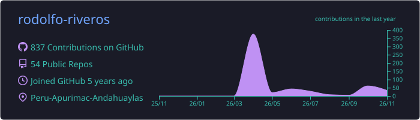
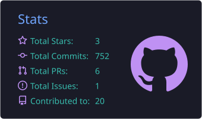
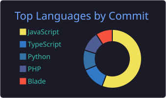
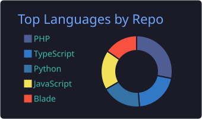
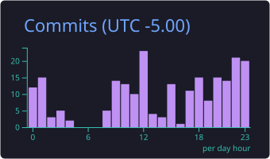

<!-- ═══════════════════════════  HEADER  ═══════════════════════════ -->
<p align="center">
  
</p>

<p align="center">
  <a href="https://portafolio-rodolfo.vercel.app">
    
  </a>
</p>

<p align="center">
  <a href="https://portafolio-rodolfo.vercel.app"></a>
  <a href="mailto:riveros70397516@gmail.com"></a>
  <a href="https://linkedin.com/in/rodolfo-riveros"></a>
  <a href="https://twitter.com/mitmariveros"></a>
  <a href="https://kaggle.com/rodolforiverosmitma"></a>
  <a href="https://instagram.com/rodolforiverosmitma"></a>
  <a href="https://fb.com/rodolfo.riveros.9843"></a>
  
</p>

<br/>

<!-- ═══════════════════════════  TERMINAL  ═══════════════════════════ -->
<p align="center">
  
</p>

<br/>

##  Sobre mí

<table>
<tr>
<td width="58%" valign="top">

Soy **Ingeniero de Sistemas** (UNAJMA) y **desarrollador Full-Stack** en **Urubamba, Cusco (Perú)**. Soy **docente en el IESP La Salle** y antes trabajé en la **UGEL Urubamba**. Hago sistemas que usan escuelas, institutos, clínicas y hoteles en su día a día, no demos que nadie abre.

- 🏫 **EdTech:** asistencia por **QR**, apps móviles para docentes que funcionan **sin internet** y exportación al **SIAGIE**.
- 🏨 **Gestión:** un **PMS hotelero** completo y finanzas **multi-clínica** para consultorios dentales.
- 🧠 **IA aplicada:** asistentes conversacionales con **Claude** y **Gemini**, unidos a modelos de **Machine Learning** propios.
- 🏛️ **Sector público:** control de asistencia docente para la **UGEL Urubamba** según la directiva MINEDU 326-2017.
- 📚 **Enseñanza:** formo a futuros técnicos y creo plataformas para aprender algoritmos e historia del Perú.
- 🎮 **Además:** apps con **Flutter** y videojuegos 3D en **Unity**.

</td>
<td width="42%" valign="top">

```yaml
nombre:     Rodolfo Riveros Mitma
rol:        Full-Stack Developer
trabajo:    Docente @ IESP La Salle
base:       Urubamba, Cusco 🇵🇪
origen:     Andahuaylas, Apurímac
formación:  Ing. de Sistemas — UNAJMA
enfoque:
  - Backend con Python y PHP
  - Web con React / Next.js
  - Mobile con Expo y Flutter
  - Integración de IA
repos:      50+ públicos
lema:       "Si no se usa, no está terminado"
```

</td>
</tr>
</table>

<br/>

## ⚡ Stack tecnológico

<p align="center"><b>Backend</b></p>
<p align="center">
  
</p>

<p align="center"><b>Frontend y móvil</b></p>
<p align="center">
  
</p>

<p align="center"><b>Móvil y videojuegos</b></p>
<p align="center">
  
</p>

<p align="center"><b>Datos, nube y herramientas</b></p>
<p align="center">
  
</p>

<p align="center">
  
  
  
  
  
  
  
</p>

<br/>

## 🏛️ Sistemas en producción

<p align="center"><sub>Sistemas que usan a diario instituciones educativas de Cusco</sub></p>

<table>
<tr>
<td width="50%" valign="top">

### 🖐️ Kunan — Control de asistencia
Asistencia con **biométricos ZKTeco** y **avisos por SMS** a los padres de familia.


</td>
<td width="50%" valign="top">

### 🏛️ SIREA — UGEL Urubamba
Control de asistencia docente según la **directiva MINEDU 326-2017** para las instituciones educativas de la **UGEL Urubamba**.


</td>
</tr>
<tr>
<td width="50%" valign="top">

### 🎓 Sistema Académico Profito
Gestión académica completa de la **EESPP La Salle**: matrículas, notas y reportes en PDF.


</td>
<td width="50%" valign="top">

### 📘 Portal Académico La Salle
Calificaciones y asistencia de los estudiantes del **IESP La Salle de Urubamba**, con autenticación JWT.


[**Demo**](https://frontend-asistencia-salle.vercel.app) · [**API**](https://github.com/rodolfo-riveros/backend-asistencia-salle)

</td>
</tr>
</table>

<br/>

## 🚀 Proyectos destacados

<table>
<tr>
<td width="50%" valign="top">

### 📲 Asistencia Escolar QR
App móvil para docentes que **pasa lista sin internet** y sincroniza después, escanea **carnés QR** con sonido y vibración y registra justificaciones. Detrás hay una API REST con JWT, reportes PDF/Excel y notificaciones push.


[**Backend**](https://github.com/rodolfo-riveros/backend-asistencia-alumno) · [**App**](https://github.com/rodolfo-riveros/app-asistencia-alumno)

</td>
<td width="50%" valign="top">

### 🧠 Asistente Hamilton
Asistente conversacional de acompañamiento emocional. Reúne los 17 ítems de la **Escala de Hamilton** conversando, clasifica con un **modelo SVM (98.7 % de exactitud)** y activa un **protocolo de crisis** si detecta señales de riesgo.


[**Backend**](https://github.com/rodolfo-riveros/asistente-hamilton-backend) · [**App**](https://github.com/rodolfo-riveros/app-asistente-depresion)

</td>
</tr>
<tr>
<td width="50%" valign="top">

### 🏨 PMS Hotel La Sallito
Sistema de gestión hotelera para el **Valle Sagrado (Cusco)**: reservas, recepción, housekeeping, restaurante, almacén, caja y facturación SUNAT simulada. Tiene **PWA**, doble factor y **prueba de carga con 100 000 reservas**.


[**Repositorio**](https://github.com/rodolfo-riveros/hotel-lasallito)

</td>
<td width="50%" valign="top">

### 🗣️ Voces de la Historia
PWA donde niños y jóvenes **conversan por voz** con 20 personajes históricos del Perú: escritores, héroes, incas y científicos.
> *"Los niños que no quieren leer, conversan con el autor."*


[**Repositorio**](https://github.com/rodolfo-riveros/voces-historia)

</td>
</tr>
<tr>
<td width="50%" valign="top">

### 🏫 Asistencia Natividad
Sistema web de asistencia para secundaria: **QR en la puerta**, asistencia por hora desde el celular del docente, alertas a apoderados y reportes **PDF/Excel con exportación al SIAGIE**.


[**Repositorio**](https://github.com/rodolfo-riveros/asistencia-estudiante)

</td>
<td width="50%" valign="top">

### 🦷 DentFinance
Gestión financiera **multi-clínica** para consultorios dentales: servicios, tratamientos, gastos y deudas por sede, con cambio de clínica activa en un clic.


[**Demo en vivo**](https://dent-finance.vercel.app) · [**Repositorio**](https://github.com/rodolfo-riveros/Dental-finances)

</td>
</tr>
<tr>
<td width="50%" valign="top">

### 🧮 Bitácora de Algoritmos
Plataforma para aprender estructuras de datos: **simuladores visuales** con el **código Python sincronizado** paso a paso (pilas con Torres de Hanói, colas, listas enlazadas y más).


[**Demo en vivo**](https://bitacora-algoritmos.vercel.app) · [**Repositorio**](https://github.com/rodolfo-riveros/bitacora-algoritmos)

</td>
<td width="50%" valign="top">

### 💻 SYS.IO — Mi portafolio
Portafolio con **terminal interactiva**, estadísticas de GitHub en vivo, efecto Matrix y versión en dos idiomas. Incluye un formulario de contacto con EmailJS.


[**Demo en vivo**](https://portafolio-rodolfo.vercel.app) · [**Repositorio**](https://github.com/rodolfo-riveros/portafolio-rodolfo)

</td>
</tr>
</table>

<p align="center">
  <a href="https://github.com/rodolfo-riveros?tab=repositories"></a>
</p>

<br/>

## 💼 Experiencia

| | Cargo | Institución | Periodo |
|:-:|---|---|---|
| 👨‍🏫 | **Docente** | IESP La Salle — Urubamba, Cusco | Abr 2026 – Dic 2026 · Mar 2025 – Dic 2025 · Jun 2024 – Dic 2024 |
| 🧾 | **Técnico en AIRHSP** | UGEL Urubamba | Feb 2024 – Jun 2024 |
| 🧾 | **Apoyo en AIRHSP** | UGEL Urubamba | Ago 2023 – Dic 2023 |
| 🛠️ | **Soporte técnico** (prácticas profesionales) | UGEL Urubamba | Abr 2023 – Jul 2023 |

<br/>

## 🎓 Formación y logros

<table>
<tr>
<td width="50%" valign="top">

**🎓 Ingeniero de Sistemas**<br/>
Universidad Nacional José María Arguedas (UNAJMA)

**🔬 Investigación**<br/>
Colaborador en el proyecto *"Influencia de una herramienta de visualización interactiva guiada en la detección de patrones cíclicos en series temporales"* (Res. N.° 034-2023-CO-UNAJMA y N.° 0456-2022-CO-UNAJMA).

**🗳️ Liderazgo**<br/>
Vicepresidente del comité electoral de la E.P. de Ingeniería de Sistemas (2019).

</td>
<td width="50%" valign="top">

**📜 Cursos y capacitaciones**

- Metodologías de Aprendizaje y Sistemas de Evaluación (2025)
- Flutter (2025)
- Programación de Videojuegos 3D en Unity (2025)
- Transformación Digital en el Perú — PCM (2024)
- Ofimática en la nube, CorelDRAW y Soporte Remoto (2024)
- Fortalecimiento en Ingeniería de Sistemas (2023)
- V Congreso Internacional de Ingeniería de Sistemas — U. de Lima (2022)
- Aplicación CRUD con PHP y MySQL (2022)

</td>
</tr>
</table>

<p align="center">
  <a href="https://portafolio-rodolfo.vercel.app"></a>
</p>

<br/>

## 📊 Estadísticas en GitHub

<!-- Tarjetas generadas por .github/workflows/profile.yml (se actualizan solas) -->
<p align="center">
  
</p>

<p align="center">
  
  
</p>

<p align="center">
  
  
</p>

<p align="center">
  
</p>

<!-- Serpiente: la genera .github/workflows/profile.yml en la rama "output" -->
<p align="center">
  <picture>
    <source media="(prefers-color-scheme: dark)" srcset="https://raw.githubusercontent.com/rodolfo-riveros/rodolfo-riveros/output/github-snake-dark.svg" />
    <source media="(prefers-color-scheme: light)" srcset="https://raw.githubusercontent.com/rodolfo-riveros/rodolfo-riveros/output/github-snake.svg" />
    
  </picture>
</p>

<br/>

## 🤝 Trabajemos juntos

<p align="center">
  Si buscas a alguien para construir un sistema web, una app móvil o integrar IA en tu producto, <b>escríbeme</b>.<br/>
  <sub>Lo que mejor sé hacer: llevar el proyecto desde los requerimientos hasta el despliegue.</sub>
</p>

<p align="center">
  <a href="https://portafolio-rodolfo.vercel.app"></a>
</p>

<!-- ═══════════════════════════  FOOTER  ═══════════════════════════ -->

